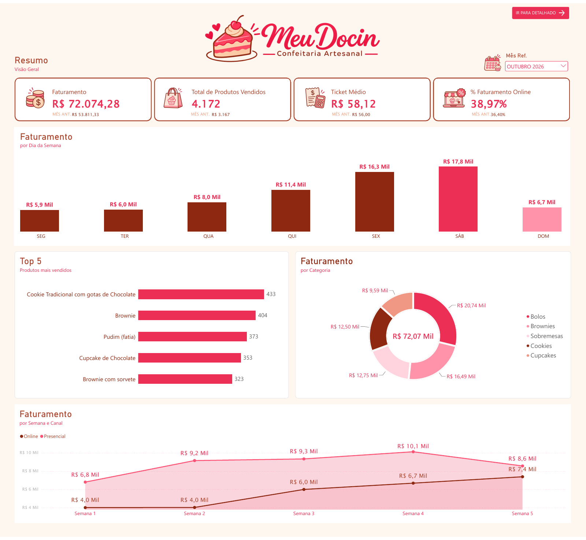
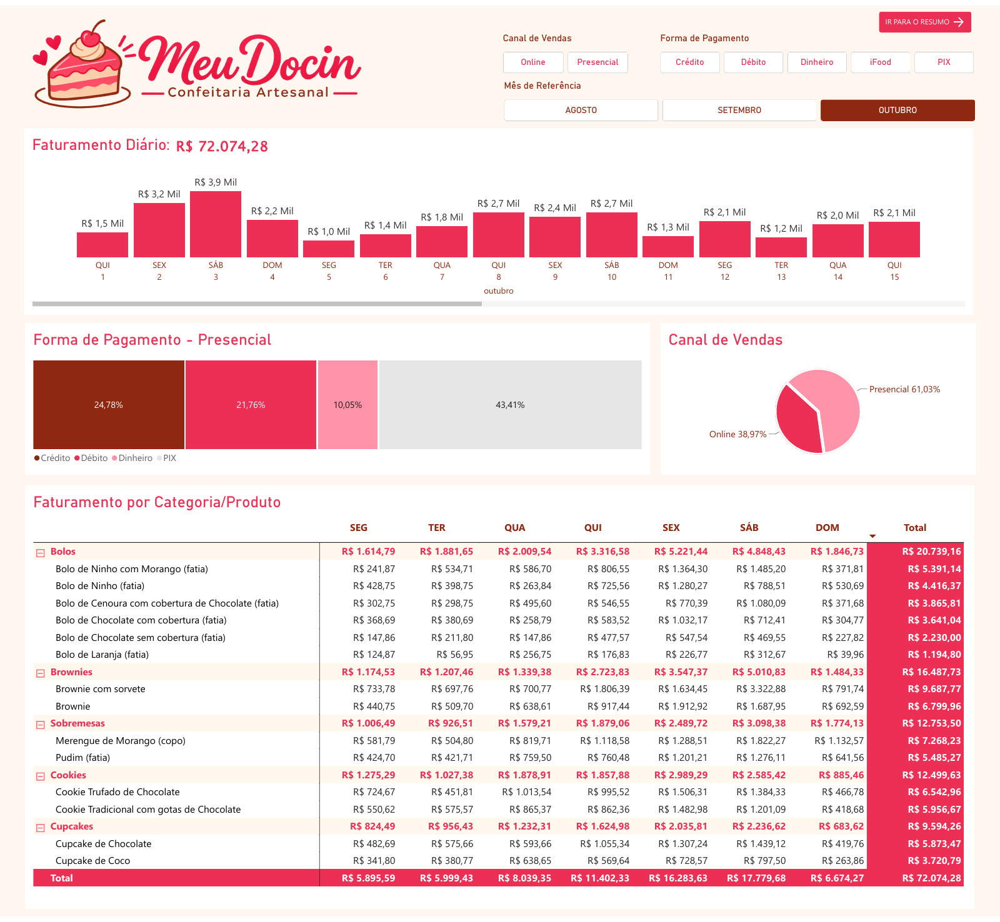
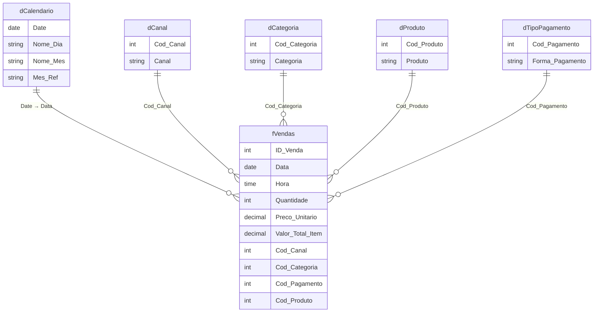

# 🍰 Meu Docin — Dashboard de Vendas (Power BI)


-217346?style=flat)


Dashboard de vendas para a **Meu Docin — Confeitaria Artesanal**, construído em Power BI para acompanhar o desempenho do estabelecimento de forma **macro** (visão geral do mês) e **detalhada** (dia a dia, categoria e produto).

> ⚠️ **Projeto de portfólio com dados 100% fictícios.** A confeitaria, as vendas, os preços e os valores exibidos foram simulados para fins de estudo e demonstração.

---

## 📌 Contexto

A dona de uma confeitaria precisa acompanhar as vendas do estabelecimento sem depender de planilhas manuais: ela quer enxergar rapidamente como o mês está indo e, quando necessário, "abrir" os números para entender onde o faturamento nasce.

A solução foi dividida em duas páginas:

| Página | Objetivo | Pergunta que responde |
|---|---|---|
| **Resumo** (macro) | Visão geral do mês, com comparação ao mês anterior | "Como o mês está indo?" |
| **Detalhado** | Análise por dia, canal, forma de pagamento, categoria e produto | "De onde vem o faturamento?" |

## 🎯 Perguntas de negócio

- Quanto a confeitaria faturou no mês e como isso se compara ao mês anterior?
- Quais dias da semana concentram as vendas?
- Quais categorias e produtos mais vendem, em quantidade e em faturamento?
- Qual a participação das vendas online (iFood) e como ela evolui semana a semana?
- Como os clientes pagam no balcão?
- Como foi o faturamento dia a dia e produto a produto?

---

## 🖼️ Prévia

### Resumo


### Detalhado


📄 Versão em PDF: [`Dashboard_de_Vendas_Meu_Docin.pdf`](Dashboard_de_Vendas_Meu_Docin.pdf)
📊 Arquivo do Power BI: [`Dashboard_de_Vendas_Meu_Docin.pbix`](Dashboard_de_Vendas_Meu_Docin.pbix)

---

## 🧭 Páginas do dashboard

### 1. Resumo (visão macro)

- **Seletor de mês de referência** (agosto, setembro ou outubro de 2026). O dashboard abre em **outubro/2026**.
- **4 indicadores (KPIs)**, cada um com o valor do **mês anterior** logo abaixo (*MÊS ANT.*):
  - Faturamento
  - Total de produtos vendidos
  - Ticket médio
  - % de faturamento online
- **Faturamento por dia da semana**, para identificar os dias fortes e fracos.
- **Top 5 produtos mais vendidos** (em quantidade).
- **Faturamento por categoria** (gráfico de rosca): Bolos, Brownies, Sobremesas, Cookies e Cupcakes.
- **Faturamento por semana e canal** (Online × Presencial), em gráfico de área.
- Botão **"Ir para detalhado"** para navegar até a segunda página.

### 2. Detalhado (visão operacional)

- **Filtros**: canal de vendas (Online / Presencial), forma de pagamento (Crédito, Débito, Dinheiro, iFood, PIX) e mês de referência.
- **Faturamento diário** do mês selecionado, com o dia da semana de cada barra (o gráfico tem rolagem horizontal; no PDF aparecem apenas os dias 1 a 15).
- **Forma de pagamento no presencial**, em barra 100% empilhada.
- **Canal de vendas** (Online × Presencial), em gráfico de pizza.
- **Matriz Categoria → Produto × dia da semana**, com faturamento por produto, subtotais por categoria e total geral. As categorias podem ser expandidas/recolhidas.
- Botão **"Ir para o resumo"** para voltar à primeira página.

---

## 🔎 Leitura dos números (outubro/2026)

> Dados fictícios — a leitura abaixo serve para mostrar o tipo de análise que o dashboard permite.

**Comparação com setembro**

| Indicador | Setembro | Outubro | Variação |
|---|---:|---:|---:|
| Faturamento | R$ 53.811,33 | R$ 72.074,28 | +33,9% |
| Produtos vendidos | 3.167 | 4.172 | +31,7% |
| Ticket médio | R$ 56,00 | R$ 58,12 | +3,8% |
| % faturamento online | 36,40% | 38,97% | +2,57 p.p. |

**Principais observações**

- **Fim de semana forte:** sexta (R$ 16,3 mil) e sábado (R$ 17,8 mil) somam cerca de **47% do faturamento do mês**. O sábado vende aproximadamente 3× mais que a segunda-feira.
- **Domingo rende mais que o esperado:** mesmo com apenas 4 horas de funcionamento (10h às 14h), o domingo (R$ 6,7 mil) supera segunda (R$ 5,9 mil) e terça (R$ 6,0 mil).
- **Categorias:** Bolos lideram com R$ 20,74 mil (≈ 28,8%), seguidos de Brownies (R$ 16,49 mil, ≈ 22,9%), Sobremesas (R$ 12,75 mil), Cookies (R$ 12,50 mil) e Cupcakes (R$ 9,59 mil).
- **Quantidade × faturamento:** o Cookie Tradicional com gotas de Chocolate é o mais vendido em unidades (433), mas o **Brownie com sorvete** lidera em faturamento (R$ 9.687,77), seguido do Merengue de Morango (copo), com R$ 7.268,23.
- **Canal online em crescimento:** o faturamento online passa de R$ 4,0 mil na 1ª semana para R$ 7,4 mil na 5ª, enquanto o presencial oscila entre R$ 6,8 mil e R$ 10,1 mil. As semanas são numeradas dentro do mês, então a primeira e a última podem ter menos dias.
- **Pagamento no balcão:** o **PIX** é a forma mais usada (43,41%), seguido de crédito (24,78%), débito (21,76%) e dinheiro (10,05%).

---

## 🗂️ Modelo de dados

Modelo em **esquema estrela**: uma tabela fato (`fVendas`) e cinco dimensões.



| Tabela | Tipo | Descrição |
|---|---|---|
| `fVendas` | Fato | Uma linha por item vendido: data, hora, quantidade, preço unitário, valor total do item e chaves das dimensões |
| `dCalendario` | Dimensão | Tabela de datas criada em DAX a partir da menor e da maior data de `fVendas` |
| `dCanal` | Dimensão | Online e Presencial |
| `dCategoria` | Dimensão | Bolos, Brownies, Sobremesas, Cookies e Cupcakes |
| `dProduto` | Dimensão | 14 produtos |
| `dTipoPagamento` | Dimensão | Crédito, Débito, Dinheiro, iFood e PIX |
| `Medidas` | Tabela de medidas | Concentra todas as medidas DAX do relatório |

Todas as relações são do tipo **muitos-para-um** (fato → dimensão), com filtro em uma direção.

### Medidas DAX

| Medida | Fórmula |
|---|---|
| `Faturamento` | `SUM(fVendas[Valor_Total_Item])` |
| `Qtd Itens` | `SUM(fVendas[Quantidade])` |
| `Total Produtos Vendidos` | `SUM(fVendas[Quantidade])` |
| `Nº de Vendas` | `DISTINCTCOUNT(fVendas[ID_Venda])` |
| `Ticket Médio` | `[Faturamento] / [Nº de Vendas]` |
| `Itens por Venda` | `[Qtd Itens] / [Nº de Vendas]` |
| `% Vendas Online` | `DIVIDE(CALCULATE([Faturamento], dCanal[Canal] = "Online"), [Faturamento])` |
| `Media Vendas por Dia` | `DIVIDE([Nº de Vendas], DISTINCTCOUNT(dCalendario[Date]))` |
| `Fat Mês Anterior` | `CALCULATE([Faturamento], PREVIOUSMONTH(dCalendario[Date]))` |
| `Total Produtos Mês Anterior` | `CALCULATE([Total Produtos Vendidos], PREVIOUSMONTH(dCalendario[Date]))` |
| `Ticket Médio Mês Anterior` | `CALCULATE([Ticket Médio], PREVIOUSMONTH(dCalendario[Date]))` |
| `% Vendas Online Mês Anterior` | `CALCULATE([% Vendas Online], PREVIOUSMONTH(dCalendario[Date]))` |

Medida auxiliar, que devolve a maior quantidade entre os 5 produtos mais vendidos no contexto filtrado:

```dax
Maior Qtd Top 5 =
VAR TopProdutos =
    TOPN (
        5,
        ALLSELECTED ( dProduto[Produto] ),
        [Total Produtos Vendidos],
        DESC
    )
RETURN
    MAXX ( TopProdutos, [Total Produtos Vendidos] )
```

### Tabela calendário (`dCalendario`)

Criada com `CALENDAR(MIN(fVendas[Data]), MAX(fVendas[Data]))`, com colunas de ano, mês, trimestre, dia, dia da semana (`Nome Dia`), semana do mês (`Num Semana no Mês`), semana do ano, `Mês-Ano`, `Mês Ref` (ex.: `OUTUBRO 2026`) e `Nome Mês`, entre outras.

---

## 🧹 Tratamento de dados (Power Query)

Os dados vêm de um único arquivo **CSV** (separador `;`, codificação UTF-8, 11 colunas) que simula a exportação de um sistema de vendas:

`ID_Venda · Data · Hora · Canal · Cod_Produto · Produto · Categoria · Quantidade · Preco_Unitario · Valor_Total_Item · Forma_Pagamento`

Etapas aplicadas no Power Query:

1. Promoção dos cabeçalhos e definição dos tipos de cada coluna (inteiro, data, hora, texto e decimal).
2. Criação das dimensões `dCanal`, `dCategoria`, `dProduto` e `dTipoPagamento`: seleção da coluna, remoção de duplicatas e inclusão de um índice como chave (`Cod_...`).
3. Na `fVendas`, mesclagem (*merge*) com cada dimensão para trazer as chaves, e remoção das colunas descritivas (`Canal`, `Categoria`, `Produto`, `Forma_Pagamento`), mantendo somente os códigos.

---

## 🧁 Sobre a base fictícia

- **Período:** 01/08/2026 a 31/10/2026 (92 dias), com ~3,3 mil vendas.
- **Funcionamento da loja:** segunda a sexta, 10h–20h · sábado, 10h–18h · domingo, 10h–14h.
- **Canais:** presencial e online (iFood). As vendas online só ocorrem entre 1 hora após a abertura e 1 hora antes do fechamento da loja física.
- **Produtos:** 14 itens, entre fatias de bolo, cookies, cupcakes, brownies, merengue e pudim, com **preços diferentes** no presencial e no online.
- **Pagamento:** presencial em PIX, débito, crédito ou dinheiro; online somente iFood.

---

## ▶️ Como abrir o projeto

**Requisitos:** [Power BI Desktop](https://powerbi.microsoft.com/desktop/) (versão atual).

1. Baixe ou clone este repositório.
2. Abra o arquivo `Dashboard_de_Vendas_Meu_Docin.pbix`. Os dados já estão carregados no arquivo, então ele abre normalmente, sem precisar do CSV.
3. Navegue entre as páginas **Resumo** e **Detalhado** pelos botões no canto superior direito.

**Para atualizar os dados:** as consultas apontam para o CSV em um caminho local do computador onde o projeto foi criado. Em outra máquina, vá em **Transformar dados** e ajuste o caminho no passo **Origem** de cada consulta que lê o arquivo (`fVendas`, `dCanal`, `dCategoria`, `dProduto` e `dTipoPagamento`). Uma alternativa mais prática é criar um parâmetro com o caminho do arquivo.

> O relatório usa o visual personalizado **Simple Image** (logos e ícones), já embutido no `.pbix`.

---

## 📁 Estrutura do repositório

```
.
├── README.md
├── Dashboard_de_Vendas_Meu_Docin.pbix   # relatório Power BI (2 páginas)
├── Dashboard_de_Vendas_Meu_Docin.pdf    # exportação do dashboard
├── base_vendas_meu_docin.csv            # base fictícia (opcional, para atualizar os dados)
├── analise_vendas_meu_docin.ipynb       # python
├── requirements.txt                     # python
└── imagens/
    ├── dashboard_resumo.png
    └── dashboard_detalhado.png
```

---

## 🚀 Ideias de evolução

- Explorar a coluna `Hora` da base para mostrar os **melhores horários de venda** por dia da semana.
- Incluir o ticket médio e a quantidade de vendas por canal na página detalhada.
- Calcular a variação percentual em relação ao mês anterior diretamente nos cartões.

---

## 🐍 Versão em Python

Os mesmos dados do dashboard, analisados com **Python (pandas e matplotlib)**.

📓 [`analise_vendas_meu_docin.ipynb`](analise_vendas_meu_docin.ipynb)

O notebook lê o CSV, calcula os indicadores por mês, gera gráficos (faturamento por dia da semana, top 5 produtos, categorias e canais) e confere os resultados com os números do Power BI.

**Como executar**
1. Instale as bibliotecas: `pip install -r requirements.txt`
2. Abra o notebook: `jupyter notebook`
3. Execute as células em ordem (*Kernel → Restart & Run All*)

---

## 👤 Autor

Feito por **Anderson** · [LinkedIn](https://www.linkedin.com/in/andersonjpedrosa)

Sugestões e feedbacks são bem-vindos! 🍪
